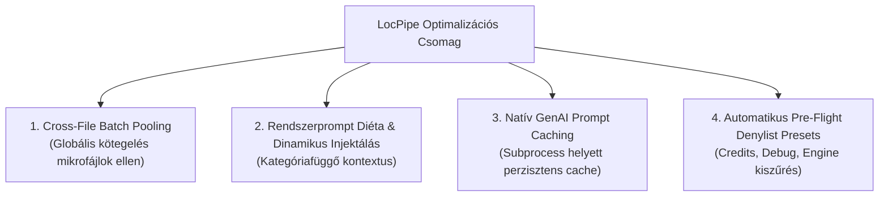

# LocPipe Future Optimization & Architecture Roadmap (PLAN.md)

Ez a dokumentum a Lost Odyssey (4 lemezes, 618 fájlos, 55 815 soros monumentális JRPG) éles lokalizációja során szerzett valós telemetriai és architekturális tapasztalatokra épül. Összefoglalja a LocPipe motor és a GameStringer ökoszisztéma következő generációs optimalizációs irányait.

---

## 1. Kiemelt Fejlesztési Irányok (Prioritási Sorrendben)

---

### §1. Cross-File Batch Pooling (A legnagyobb sebesség- és tokennövelő tényező)

#### A probléma háttere (Lost Odyssey telemetria)
- A Lost Odyssey 618 fájljából **195 fájlban 15 vagy annál kevesebb sor található** (összesen 1 018 sor, fájlonként átlagosan ~5 sor).
- Jelenleg a `pipeline.py` fájlonként hívja a `build_batches()` függvényt. Emiatt 195 különálló LLM hívás indult el 2–5 soros mikrokérésekért!
- Minden mikrohívás újra elküldte a teljes ~2 800 tokenes rendszerpromptot $\rightarrow$ **~546 000 bemeneti token és 20-25 perc tiszta futásidő veszett kárba**.
- 90-es kötegméret mellett mind az 1 018 sor kényelmesen elfért volna **mindössze 11 hívásban** a 195 helyett!

#### A megvalósítás terve
1. **Medence (Pool) alapú kötegelés:**
   - A `translate_file_window` alatt beolvasott fájlok egyedi, fordításra váró sorait ne fájlonként, hanem kategóriánként (`dialogue`, `combat_items`, `ui`) egy közös pufferbe gyűjtse.
   - A `build_batches()` ebből a közös pufferből építse fel a kötegeket a megadott `batch_size` (pl. 90-100 sor) eléréséig, függetlenül attól, hogy a sorok melyik fájlból jöttek.
2. **Lossless visszatöltés:**
   - A LocPipe `Entry` modellje már most is tárolja a forrásfájlt (`entry.file`) és a kulcsot (`entry.key`).
   - A válaszok feldolgozásakor a `merge_all()` a meglévő logika szerint írja vissza a sorokat az eredeti fájlokba. A fizikai fájlstruktúrát nem kell bántani.
3. **Várható haszon:**
   - **15–25%-kal kevesebb API hívás** sokfájlos projekteknél.
   - **500 000 – 1 000 000 bemeneti token megtakarítás** projektenként.
   - **15–30 perccel rövidebb teljes futásidő**.

---

### §2. Rendszerprompt Diéta & Dinamikus Injektálás

#### A probléma háttere
- Jelenleg minden egyes hívásnál fixen bekerül a promptba:
  - Teljes stílusútmutató (`lang-style.md`)
  - Teljes karakterszemélyiség-biblia (`character-voices.md`)
  - Minőségbiztosítási tiltólista (`anti-fabrication-checklist.md`)
  - Szűrt szószedet (`glossary.md`)
- Ez ~2 800 tokent tesz ki minden egyes hívásnál. 1 100 hívásnál ez **több mint 3 millió bemeneti token**, még akkor is, ha a kötegben csak gombfeliratok (pl. *"Mentés"*, *"Kilépés"*) vagy tárgynevek vannak!

#### A megvalósítás terve
1. **Kategóriavezérelt Karakterhang-kizárás:**
   - Ha a kategória beállítása `needs_character_voice: false` (pl. `ui`, `combat_items`, `menus`), a `prompt_builder.py` **egyáltalán ne fűzze hozzá a `character-voices.md` tartalmát**.
2. **Kompakt, táblázatos stílusszabályok:**
   - A stílusútmutatók és tiltólisták tömörítése: hosszú magyarázó bekezdések helyett strukturált, lényegretörő szabálypontok.
3. **Várható haszon:**
   - A UI és harcrendszeri kötegek alappromptja **2 800 tokenről ~1 200 tokenre csökken**.
   - ~1,0 – 1,5 millió bemeneti token megtakarítás projektenként.

---

### §3. Natív Gemini Context Caching (SDK támogatás)

#### A probléma háttere
- Az `antigravity_cli` provider subprocess hívásokkal operál (minden hívás különálló CLI folyamat).
- Bár stabil és izolált, a felhő oldalon nincs perzisztens munkamenet, így a Google nem tudja automatikusan gyorsítótárazni az ismétlődő statikus promptrészeket.

#### A megvalósítás terve
1. **Közvetlen `google-genai` SDK integráció Context Cachinggel:**
   - Létrehozni egy dedikált `gemini_cached` providert a LocPipe-ban.
   - A futás indulásakor a statikus rendszerutasításokat, stílusútmutatót és globális szószedetet explicit módon elmenti egy időzített Gemini Context Cache-be (TTL: futás hossza, pl. 2-4 óra).
   - Az egymást követő 1 000+ köteg már a cache-elt kontextusra hivatkozik, így csak a köteg tényleges JSON payloadja kerül elszámolásra.
2. **Várható haszon:**
   - **Akár 75-80%-os költség- és bemeneti token csökkenés** nagy projekteknél.
   - Még gyorsabb válaszidők a szerveroldali cache találatok miatt.

---

### §4. Intelligens Pre-Flight Denylist Presets (Stáblista és Debug szűrők)

#### A probléma háttere
- A Lost Odyssey tesztje rávilágított:
  - A stáblista (`roll_int.bin`, 795 bejegyzés) fordítása felesleges (fejlesztők nevei) és veszélyes (bonyolult animációs escape tag-ek).
  - A belső tesztmenük (`_debug.jmd`, 154 bejegyzés) sosem jelennek meg a játékosnak.
  - A játékmotor belső hibajelzései (`coalesced.int` -> `core/`, `engine/`, 312 bejegyzés) csak fejlesztői üzenetek.
- Ezek kizárásával **1 259 bejegyzést és 40-50 API hívást spóroltunk meg**.

#### A megvalósítás terve
1. **Auto-Discovery a `locpipe audit` parancsban:**
   - A `locpipe audit --suggest` automatikusan ismerje fel a tipikus nem-játék fájlneveket és mintákat:
     - `roll_*`, `*credit*`, `*staff*` (Stáblisták)
     - `*debug*`, `*test_*`, `*dummy*` (Fejlesztői menük)
     - `engine/*`, `core/*`, `editor/*` (Motor belső szövegek)
   - Jelenítsen meg egy figyelmeztetést: *"Találtunk 3 valószínűleg nem-játék fájlt (1 259 sor). Szeretnéd felvenni az exclude listára?"*
2. **GameStringer GUI integráció:**
   - Egy kattintásos gomb a GUI Preflight fülén: *"Nem-játék szövegek (Credits, Debug) automatikus kizárása"*.
3. **Várható haszon:**
   - Megszűnik a hibás stáblista-tördelések kockázata.
   - Az új projektek beállítása azonnal a legoptimálisabb tokenfogyasztással indul.

---

### §5. Megerősített Paritás-alapú Ellenőrzés (Quote & Punctuation Parity)

#### Amit már megvalósítottunk a Lost Odyssey során (És megőrzendő):
- A `quote_balance.py`-ban bevezetett forrás-paritás elv: ha a játék dialógusa több szövegdobozra van vágva és a forrásban is páratlan számú idézőjel van, a magyar fordítás azonos idézőjelezése **nem minősül hibának**.
- Ez megakadályozta, hogy 1 002 érvényes magyar sor visszahulljon az angol eredetire (`fallback passthrough`).

#### Következő lépés:
- Terjesszük ki a forrás-paritás elvét a többi írásjelre is:
  - Gondolatjelek és három pontok (`...` vs `…` vs `--`)
  - Többszörös felkiáltójelek és kérdőjelek (`?!`, `!!`, `???`)
  - Ha a játék motorja specifikus zárójelezést vagy tördelést használ a forrásban, a validátor vegye figyelembe a forrás szerkezetét ahelyett, hogy univerzális izolált mondatként értékelné.

---

## 2. Megvalósítási Ütemterv (Roadmap)

| Fázis | Feladat | Érintett komponensek | Becsült hatás |
|---|---|---|:---:|
| **Fázis 1** | **Cross-File Batch Pooling** | `pipeline.py`, `dedupe.py` | -20% hívás, -600k token |
| **Fázis 2** | **Prompt Diéta (Kategóriavezérelt hangok)** | `prompt_builder.py`, `pipeline.py` | -30% bemeneti token |
| **Fázis 3** | **Pre-Flight Denylist Presets** | `auto_suggest.py`, `uabea_json.py`, Desktop GUI | 0 kockázat, -1 000+ sor |
| **Fázis 4** | **Natív Context Caching SDK** | `providers/gemini_cached.py` | -75% tokenköltség |

---

*Készült: 2026. október 22. — Lost Odyssey (PC Recompiled) lokalizációs benchmark alapján.*
